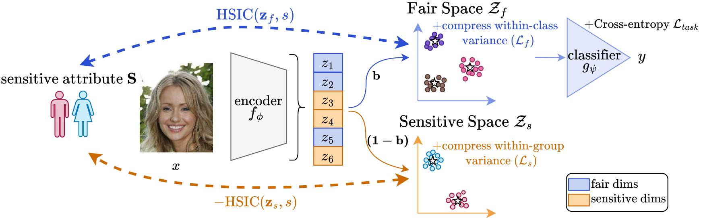

<div align="center">

# FairSplit: Decomposing the Embedding Space for<br> Fair Classification

**Andrii Shkabrii**<sup>1,2</sup> · **Anna Beer**<sup>3,1</sup> · **Ylli Sadikaj**<sup>1</sup> · **Claudia Plant**<sup>1,4</sup>

<sup>1</sup>Faculty of Computer Science, University of Vienna, Vienna, Austria<br>
<sup>2</sup>Doctoral School Computer Science, University of Vienna, Vienna, Austria<br>
<sup>3</sup>Webster Vienna Private University, Vienna, Austria<br>
<sup>4</sup>Research Network Data Science, University of Vienna, Vienna, Austria

*NeurIPS 2026* 🇦🇺

[](https://www.python.org/)
[](https://pytorch.org/)



</div>

**FairSplit** learns to split the embedding of a classifier into two parts: a **Fair Space**, used for prediction, and a **Sensitive Space**, which collects information about the sensitive attribute. A learnable mask assigns each embedding dimension to one of the two spaces, and the Hilbert-Schmidt Independence Criterion (HSIC) pushes the Fair Space towards independence from the sensitive attribute while keeping the Sensitive Space dependent on it. Since the classifier reads only the Fair Space, moving sensitive information into the Sensitive Space reduces the classifier's dependence on the sensitive attribute.

## Installation

The code requires Python 3.12 and uses [uv](https://docs.astral.sh/uv/) for the environment.

```bash
git clone https://github.com/shkabrii/fairsplit.git
cd fairsplit
uv sync
source .venv/bin/activate
```

## Data

Download each dataset from its original source and place it under `data/`, or pass another folder with `--data`:

```
data/
├── adult/raw/  compas/raw/  celeba/raw/  utkface/raw/   # benchmarks of Tables 2 and 3
├── fairface/                                          # pixels_224.npy, labels.csv
└── celeba-fm/
    ├── fairerclip/                                    # FairerCLIP features and labels
    └── celeba_dinov2L_full.npz                        # DINOv2 ViT-L/14 features
```

<details>
<summary><b>Benchmarks: Adult, COMPAS, CelebA, UTKFace</b></summary>

Download the four datasets as described in the [FFB datasets readme](https://github.com/ahxt/fair_fairness_benchmark/tree/master/datasets) and place them in the folders above.

</details>

<details>
<summary><b>FairFace (fine-tuned ViT-B/16)</b></summary>

Downloads FairFace from the Hugging Face Hub and writes the 224×224 images and the labels:

```bash
uv run --extra fairface python scripts/prepare_fairface.py --out data/fairface
```

</details>

<details>
<summary><b>CelebA with frozen foundation models</b></summary>

- **CLIP ViT-L/14 and CLIP ResNet-50.** Download the pre-extracted features and labels released by [FairerCLIP](https://github.com/human-analysis/FairerCLIP) and place their contents in `data/celeba-fm/fairerclip/`.
- **DINOv2 ViT-L/14.** Download the aligned images (`img_align_celeba`), `list_attr_celeba.txt` and `list_eval_partition.txt` from the [official CelebA page](https://mmlab.ie.cuhk.edu.hk/projects/CelebA.html), then extract the features:

```bash
python scripts/prepare_celeba_dinov2.py --img_dir <img_align_celeba> \
    --attr_file <list_attr_celeba.txt> --partition_file <list_eval_partition.txt> \
    --out data/celeba-fm/celeba_dinov2L_full.npz
```

</details>

## Reproducing the paper

Each config in `configs/` describes one method on one dataset and runs 5 seeds. Results are written to `results/<dataset>/<method>/seed<n>.json`.

```bash
python train.py configs/adult/fairsplit.yaml
```

Single seeds and changed settings are passed on the command line, for example `--seeds 0` or `sigma=2.0`.

```bash
# Tables 2 and 3: ERM, FairSplit and the fairness baselines
for c in configs/{adult,compas,celeba-a,utkface-ar}/*.yaml; do python train.py $c; done

# Table 4: fine-tuned ViT-B/16 on FairFace and frozen backbones on CelebA
for m in erm fairsplit; do
    python train.py configs/fairface/$m.yaml
    for b in clip_ViTL14 clip_RN50 dinov2L_full; do python train.py configs/celeba-fm/$m.yaml backbone=$b; done
done

# Mean ± standard deviation over seeds
python scripts/summarize.py results
```

Each dataset folder holds one config per method, with the hyperparameters selected in the appendix of the paper:

| method | config | Adult | CelebA-A | UTKFace-AR | COMPAS |
|---|---|:-:|:-:|:-:|:-:|
| ERM | `erm` | ✓ | ✓ | ✓ | ✓ |
| AdvDebias | `advdebias` | ✓ | ✓ | ✓ | ✓ |
| HSIC(Y,S) | `hsic_ys` | ✓ | ✓ | ✓ | ✓ |
| FairMixup | `fairmixup` | ✓ | ✓ | | |
| DRAlign | `dralign` | ✓ | ✓ | | |
| PRemover | `premover` | ✓ | ✓ | | |
| DiffMCDP | `diffmcdp` | ✓ | ✓ | | |
| FairSplit | `fairsplit` | ✓ | ✓ | ✓ | ✓ |

## Adding a method

A method is a small class in its own file in `src/methods/`, registered in `src/methods/__init__.py`. It wraps the encoder and returns the training loss for a batch; data loading, the training loop and the evaluation are shared.

```python
# src/methods/my_method.py
from src.methods.erm import ERM, classification_loss


class MyMethod(ERM):
    def loss(self, x, y, s, warmup):
        h, out = self.model(x)
        loss = classification_loss(out, y)
        if warmup:
            return loss
        return loss + self.cfg.lam * my_penalty(out, s)
```

Then add `"my_method": MyMethod` to `METHODS` in `src/methods/__init__.py`.

During the first `warmup` steps only the classification loss is used; at step `warmup` the optimizer is reset. Any key in the config, such as `lam`, is available as `self.cfg.lam`. Methods that need one batch per sensitive group set `paired = True` and receive two batches.

```bash
echo -e "dataset: adult\nmethod: my_method\nwarmup: 50\nlam: 1.0" > configs/adult/my_method.yaml
python train.py configs/adult/my_method.yaml
```

## Repository structure

```
train.py              # training and evaluation
src/
├── data.py           # dataset loading and splits
├── models.py         # MLP, ResNet-18, ViT-B/16
├── metrics.py        # utility and fairness metrics
└── methods/          # one file per method, registered in __init__.py
    ├── erm.py        # ERM, the base class of all methods
    ├── fairsplit.py  # FairSplit: mask, compression losses, HSIC and the training loss
    └── advdebias.py, fairmixup.py, dralign.py, hsic_ys.py, premover.py, diffmcdp.py
configs/<dataset>/<method>.yaml
scripts/              # data preparation and result summary
```

## Acknowledgements

This codebase builds on the [Fair Fairness Benchmark (FFB)](https://github.com/ahxt/fair_fairness_benchmark) and the [MCDP codebase](https://github.com/mitao-cat/icml24_mcdp): the data pipeline, the training setup and the evaluation metrics follow them, and the baselines are ported from their implementations. The HSIC estimator, the centroid updates and the compression losses are adapted from [H-SPLID](https://github.com/neu-spiral/H-SPLID). We thank the authors for making their code available.


## Citation

If you use this code in your research, please cite (NeurIPS citation coming soon):

```bibtex
@misc{shkabrii2026fairsplitdecomposingembeddingspace,
      title={FairSplit: Decomposing the Embedding Space for Fair Classification}, 
      author={Andrii Shkabrii and Anna Beer and Ylli Sadikaj and Claudia Plant},
      year={2026},
      eprint={2610.39031},
      archivePrefix={arXiv},
      primaryClass={cs.LG},
      url={https://arxiv.org/abs/2610.39031}, 
}
```
